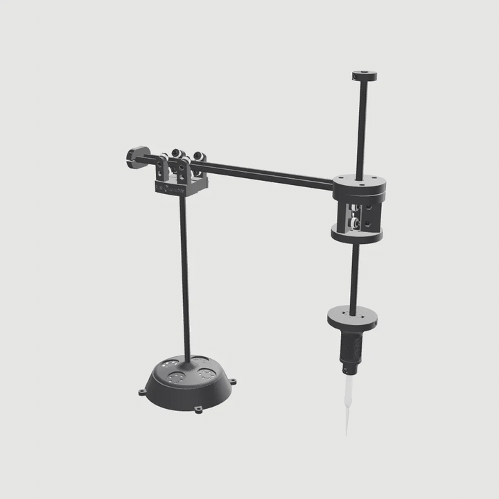
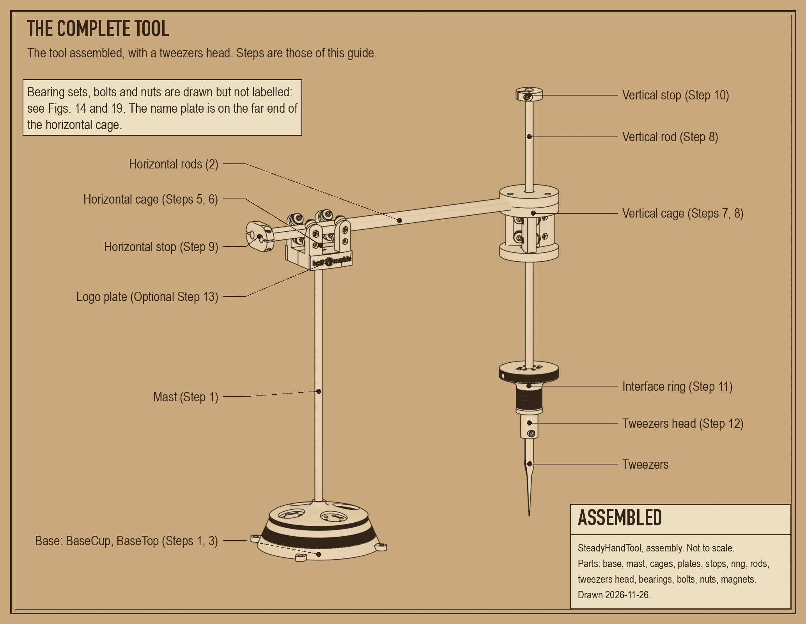

[](https://halfmarble.com/gallery.html)

# Steady Hand Tool

<p align="center">
  
</p>

## See it in Action
<p align="center">
  <a href="https://www.youtube.com/watch?v=Imng8o2QRBg">
    
  </a>
  <br>
  <em>Demonstrating the stability and precision of the Steady Hand Tool.</em>
</p>

---

Steady Hand Tool is a manual SMD (Surface Mount Device) assembly stabilizer designed to help makers and professionals prototype PCBs with high precision. Originally created to overcome physical challenges—specifically hand tremors caused by Parkinson’s disease—this tool makes high-accuracy soldering accessible to everyone.

## 🌟 Key Features

* **Stabilized 4-DOF Movement:** Keeps your hand on a steady track while allowing full vertical and horizontal reach.
* **Near-Zero Friction:** Equipped with **14 high-quality metal bearings** and carbon fiber rods for smooth, silent, and effortless operation.
* **Modular Magnetic Coupler:** Features a quick-swap magnetic system for changing tool heads (tweezers, vacuum tips, etc.) in seconds.
* **Purely Mechanical:** No power required, no cables, and no noise. It's always ready to work when you are.
* **Heavy-Duty Base:** A weighted **785g (1.7 lb)** base keeps the arm upright at full extension with a tool head fitted. With the weight cup on the vertical stop (even empty), or when you press down on the tool, draw the arm in from full extension first.
* **Open Source:** Designed to be hacked and customized. Create your own tool heads to suit your specific workflow.

## 🚀 Get Yours

<p align="center">
  <a href="https://www.crowdsupply.com/halfmarble/steady-hand-tool">
    
  </a>
</p>

<p align="center">
  <b>The Steady Hand Tool is coming to <a href="https://www.crowdsupply.com/halfmarble/steady-hand-tool">Crowd Supply</a>.</b><br>
  Sign up to be notified when the campaign launches.
</p>

---

## 🛠 Technical Specifications

* **Reach:** Approximately 250 mm (9.8 in) vertical and horizontal travel.
* **Construction:** 3D-printed components (optimized for PETG/Carbon Fiber) and 8mm carbon fiber rods.
* **Bearings:** MR128ZZ precision shielded bearings.
* **Compatibility:** Designed to support a pair of specialized reverse tweezers optimized for 0805-size components and smaller.

> [!TIP]
> **Looking to build it?** Check out our [Assembly Guide](https://github.com/halfmarble/SteadyHandTool/blob/main/docs/assembly-guide.md) for step-by-step instructions.

## 📂 Repository Structure

```
steady-hand-tool/
├── hardware/
│   └── models/
│       ├── stl/            # Printable parts and tool-head adapters
│       ├── 3rdParty/       # Adapters for third-party tools (PixelPump)
│       └── 3mf/            # Print plates — orientation and slicer settings, not geometry
├── docs/
│   ├── assembly-guide.md   # Step-by-step build instructions
│   ├── BOM.md              # Bill of Materials (the "Shopping List")
│   ├── illustrations/      # Assembly and magnet seating illustrations
│   ├── images/             # Photos of the parts you buy (BOM)
│   ├── magnets.md          # Magnet polarity, seating and the optional rig
│   └── print.md            # What to print, and how
├── media/                  # The animation and the illustration on this page
├── LICENSE                 # CERN-OHL-S-2.0 License text
└── README.md               # This file
```

### The parts, and which are published

<p align="center">
  
</p>

| Part | Status | Notes |
| :--- | :--- | :--- |
| `Pillar.stl` | ✅ Published | Upright strut — carries the pivot pins the arm swings on |
| `Spacer.stl` | ✅ Published | The "fat" spacer — ⌀10.8 body on a ⌀8 spigot. One per bearing set (14 sets) |
| `SpacerSmall.stl` | ✅ Published | The "thin" spacer, same three diameters. One per bearing set |
| `Stopper.stl` | ✅ Published | Split clamp collar for an 8 mm rod, M3 cross screw |
| `Aligner.stl` | ✅ Published | Horizontal stop |
| `InterfaceRing.stl` | ✅ Published | The ring that interfaces with the tool head, with a knurled band round its neck, a knurled rim and a plain curved flare under the rim (assembly guide, Step 11) |
| `PlateSteadyHandTool.stl` | ✅ Published | Name plate (Optional Step 13) |
| `PlateHalfLogoMarble.stl` | ✅ Published | Logo plate (Optional Step 13) |
| `InterfaceTweezers.stl`, `InterfaceManualVacuumPen.stl`, `InterfaceTemplate.stl` | ✅ Published | Tool heads. `InterfaceTemplate` is the blank to start your own from |
| `MagnetPusherNBody.stl` and its two letters, `MagnetPusherSBody.stl` and its two letters, `MagnetPusherSleeve.stl` | ✅ Published | The two magnet pushers, N and S, and a tip sleeve for each: they seat each magnet with the right pole facing out ([magnets guide](docs/magnets.md)) |
| `MagnetCouponMouthUp.stl`, `MagnetCouponMouthDown.stl` | ✅ Published | The two magnet coupons: print them first to check that your printer makes magnet seats that grip ([how to read them](docs/magnets.md#1-dial-in-your-printer-first-the-two-magnet-coupons)) |
| `MagnetRigPuck.stl`, `MagnetRigPusher.stl`, `MagnetRigCap.stl` | ✅ Published | The magnet rig: an optional guide for seating the base's tool-pocket magnets, not yet used on a printed base ([how to use it](docs/magnets.md#9-the-magnet-rig-the-bases-tool-pockets-guided)) |
| Horizontal cage | ⏳ On funding | Assembly guide, Steps 5–6 |
| Vertical cage — three parts | ⏳ On funding | Steps 7–8 |
| Base — printed cup and screw-in top | ⏳ On funding | Filled with steel shot to 785 g (Step 1) |
| Weight cup and its screw-on lid, two of each | ⏳ On funding | [Print list](docs/print.md) |

Quantities per tool are in the [assembly guide](docs/assembly-guide.md), not repeated here.

**Every 3D model will be published when the campaign funds** — that is the commitment, and it is
part of what backing it pays for. Until then the [BOM](docs/BOM.md) and the
[assembly guide](docs/assembly-guide.md) describe the carriage and the base, and the
[magnets guide](docs/magnets.md) is the full specification any tool head you
design has to match — so designing one is something you can do today, not after the campaign.

---

## ⚙️ Our Mission

"It's the only tool that I have, to help me and others manage our own **slice of PD hell.**"

The Steady Hand Tool is an engineering response to a personal biological war. It exists because "making" is a vital part of staying human. Inspired by the lived reality of Parkinson’s Disease, this tool is engineered to ensure that biological constraints never dictate the boundaries of human creativity.

## 🔧 Our Support

This is a race against time and biology. We invite you to pick up a wrench and help us optimize the hardware for the next generation of makers facing similar constraints. Feedback, CAD iterations, and mechanical refinements are the high-octane fuel that keeps this engine running.

<p align="left">
  <b>10% of the net profit</b> from selling the Steady Hand Tool will go directly to support
  <a href="https://give.michaeljfox.org/halfmarble">Team Fox</a>, the grassroots fundraising program of
  The Michael J. Fox Foundation for Parkinson’s Research.
  <br>
  <em>halfmarble is an independent Team Fox third-party fundraiser.</em>
</p>

---

## License

This project is licensed under the [**CERN-OHL-S-2.0 License**](https://choosealicense.com/licenses/cern-ohl-s-2.0/) - see the [LICENSE](LICENSE) file for details.

## Trademarks

The license above covers this repository’s hardware designs and documentation. It grants no rights to any trademark, trade name, or logo — including the Team Fox and Michael J. Fox Foundation marks, and halfmarble’s own.
