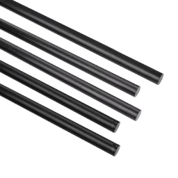
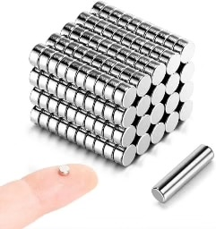
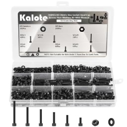
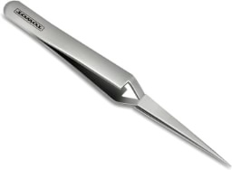
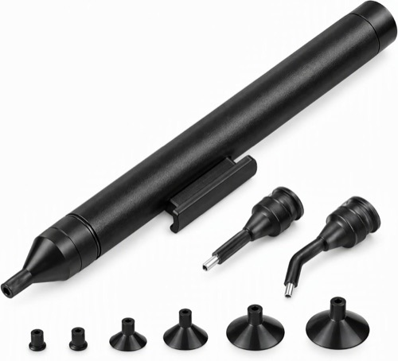
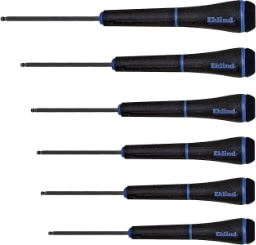

# Steady Hand Tool

**A stabilizing pick-and-place arm for precision SMD assembly.**

---

## 🛒 Bill of Materials (BOM)

The Steady Hand Tool is designed for easy sourcing. You can find the links and visual references for each component below.

### 🏗️ Structural Hardware

| Image | Item | Specification | Purpose |
| :---: | :--- | :--- | :--- |
|  | [**Carbon Fiber Rods**](https://www.amazon.com/dp/B0CXP6992R) | 8mm Diameter x 300mm | 2 horizontal rails, 1 vertical mast, 1 vertical tool rod. **4 required** |
|  | [**MR128ZZ Bearings**](https://www.amazon.com/dp/B075CM2XNJ) | 8 x 12 x 3.5mm | Frictionless carriage movement. **14 required** |
|  | [**Magnets**](https://www.amazon.com/dp/B08NZS7WBK) | 4mm x 2mm Neodymium | Magnetic tool coupler interface. **Orientation matters** — see the [magnets guide](magnets.md). **78 required**, buy at least 90 |
|  | [**Steel balls**](https://www.amazon.com/dp/B00JZ18B1A) | 1/4 inch | Round steel shot, about **660 g** per base: fills the printed base to **785 g** with its 24 magnets seated. |
|  | [**Cast steel shot**](https://www.amazon.com/dp/B09G3LBN26) | S-780, about 2 mm | Option, in place of the steel balls: about **660 g** per base, filled by weight to **785 g** with its 24 magnets seated. |

**Magnet count, broken down:** 24 in the base (four tool pockets, six each), 12 in the two tool
heads (tweezers and vacuum pen, six each), 12 in the interface ring (six on the bottom face and six
on the top), 6 in the vertical cage, 6 in the aligner, 6 in the stopper and 12 in the two weight
cups (six each) — 78 in total. Buy 90; they are small, and one will find the floor.

### 🔩 Fasteners

| Image | Item | Specification | Purpose |
| :---: | :--- | :--- | :--- |
|  | [**M3 Hardware**](https://www.amazon.com/dp/B0F4XNN1T3) | Stainless steel. 33 x M3 16mm, 2 x M3 8mm, and 29 M3 nuts | Structural assembly of the arm and the base's rod clamp |

Buy a few spares of each size. **One M3x16 and its nut go into the base**, where they close the
clamp on the vertical mast; every other one goes into the arm. The step-by-step breakdown is in the
[assembly guide](assembly-guide.md#-preparation-fasteners-sorting).

### 🧩 Fasteners and magnets per part

Where each fastener and magnet above goes. **Qty** is how many of the part one tool has; the
printed parts are in the [print list](print.md).

| Part | Qty | M3 8mm | M3 16mm | M3 nuts | Magnets |
| :--- | :---: | :---: | :---: | :---: | :---: |
| Horizontal cage | 2 | – | 12 for the pair | 12 for the pair | – |
| Pillar | 3 | – | 2 each = 6 | 2 each = 6 | – |
| Vertical cage, bottom | 1 | – | 3 | – | 6 |
| Vertical cage, middle | 1 | – | 3 | 3 | – |
| Vertical cage, top | 1 | – | 3 | – | – |
| Aligner (horizontal stop) | 1 | – | 2 | 2 | 6 |
| Stopper (vertical stop) | 1 | – | 1 | 1 | 6 |
| Interface ring | 1 | – | 2 | 2 | 12 |
| Tool head (tweezers) | 1 | 2 | – | 2 | 6 |
| Tool head (vacuum pen) | 1 | – | – | – | 6 |
| Weight cup | 2 | – | – | – | 6 each = 12 |
| Base | 1 | – | 1 | 1 | 24 |
| **Total** | | **2** | **33** | **29** | **78** |

- 14 of the 33 M3x16 go through the bearing sets: 8 in the two horizontal cages and 6 in the
  pillars. Of the cages' other 4, two join the two cages to each other and one in each cage
  clamps the vertical mast.
- The 3 M3x16 of the **Vertical cage, bottom** and the 3 M3x16 of the **Vertical cage, middle** form
  their own thread in the pillars and take no nut.
- The 3 M3x16 of the **Vertical cage, top** go in from that part and pass into the
  **Vertical cage, middle**, where their nuts sit.
- The M3x16 and nut of the **Base** close the rod clamp inside the **BaseCup** on the vertical
  mast. Tighten it before any shot goes into the open BaseCup; the clamp ends up under the shot.
  See [Step 1 of the assembly guide](assembly-guide.md#step-1-base).
- The M3x8 and their nuts clamp the tweezers. A vacuum-pen or template head takes none.
- The interface ring stays on the tool; the tool heads come off it.

### 🔧 Tools

| Image | Item | Specification | Purpose |
| :---: | :--- | :--- | :--- |
|  | [**Reverse Tweezers**](https://www.amazon.com/dp/B07V8SLF2T) | Reverse action (self-closing) — squeeze to open | Holding SMD parts during placement |
|  | [**Manual Vacuum Pen**](https://www.amazon.com/dp/B0BKSL9CHZ) | Manual suction pen with straight and bent tips and suction cups | Picking up SMD parts; used with the vacuum-pen tool head |
|  | [**Ball-Hex Drivers**](https://www.amazon.com/dp/B0021O1A1G) | Metric Allen Key Set | Recommended for assembly |
