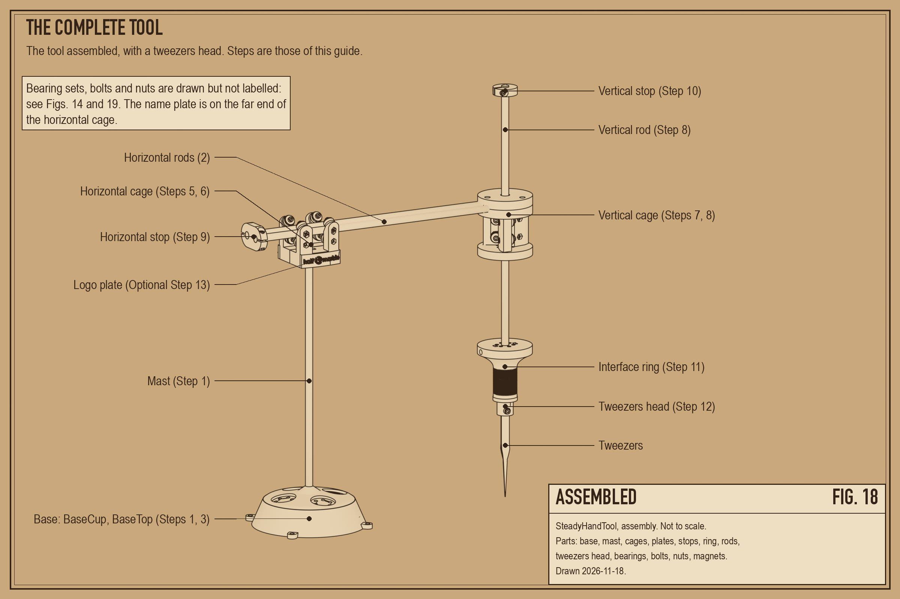
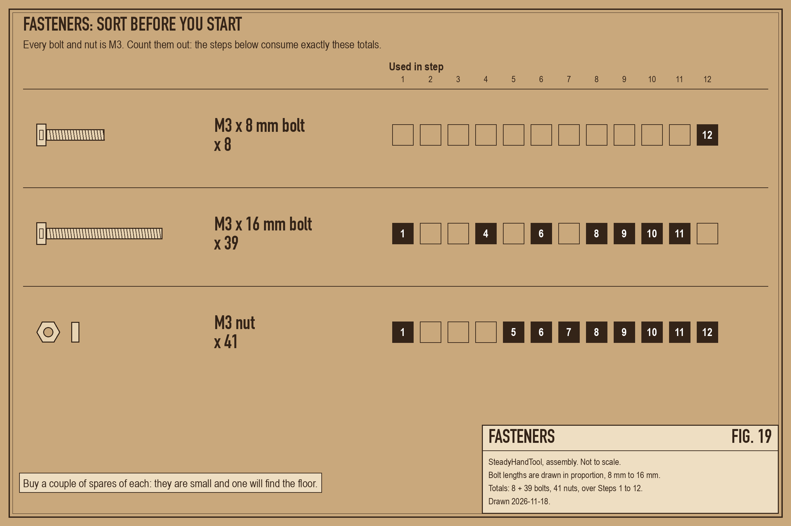
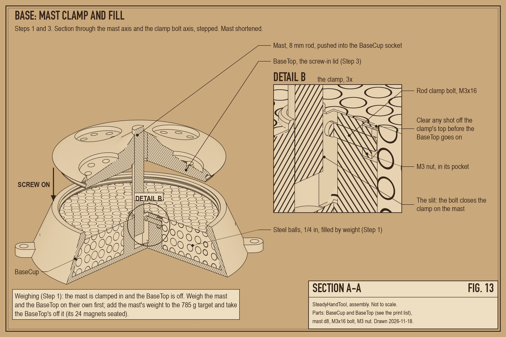
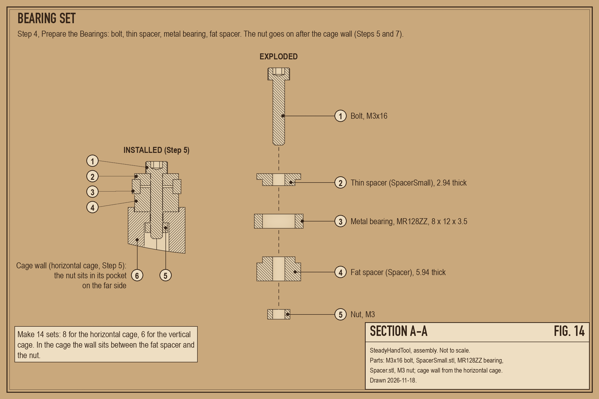
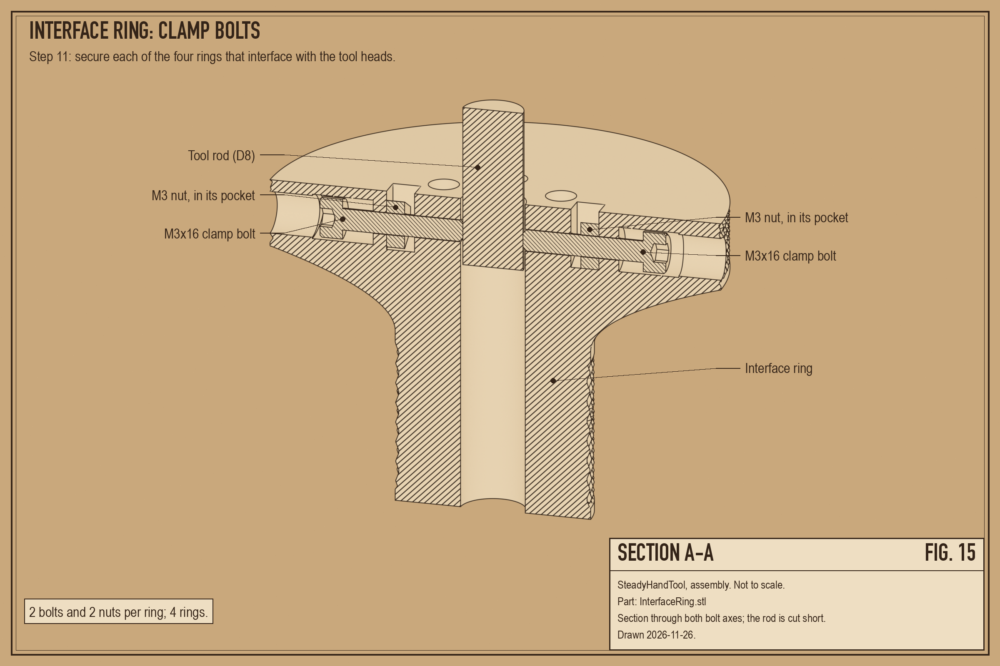
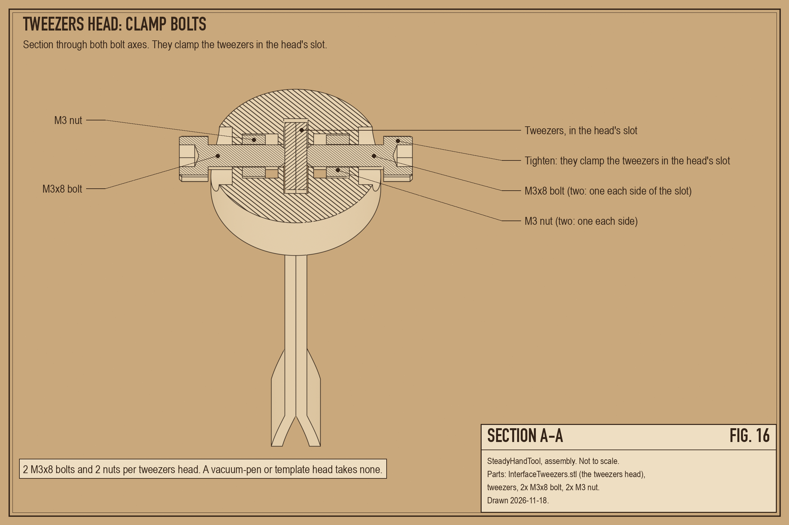
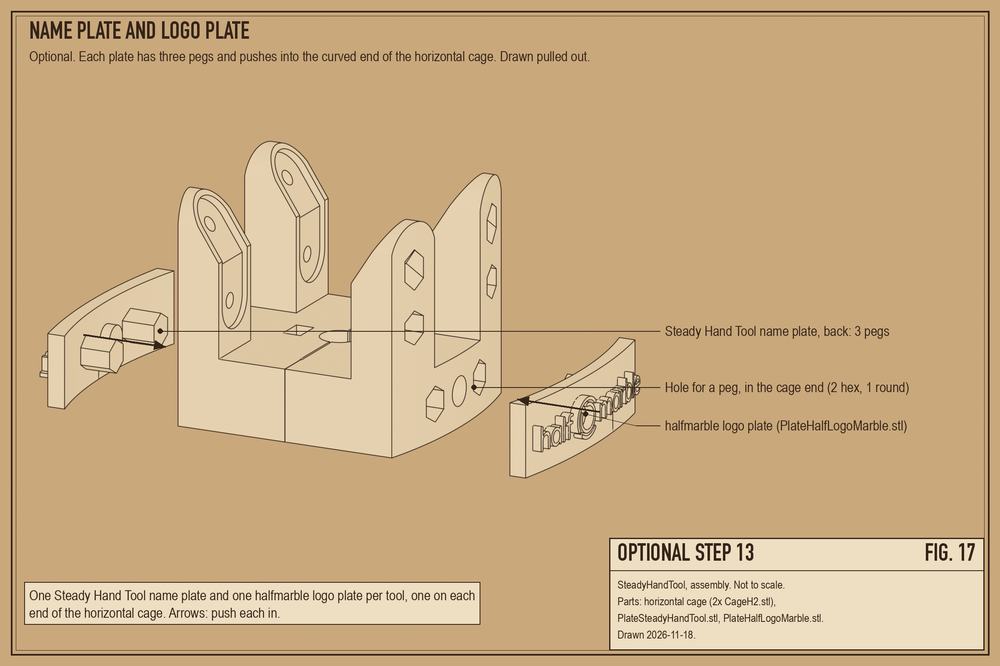

# Steady Hand Tool Assembly Guide - Part 1

This assembly guide is based on the [Steady Hand Tool DIY Part 1](https://www.youtube.com/watch?v=_OBHK19EvW4) video tutorial.

**Estimated Time:** 30 Minutes

---

## 🛠️ Required Tools
* **2.5mm** Hexball screwdriver

---

## 🔩 Preparation: Fasteners Sorting
Every bolt and nut is M3. Before starting, sort the bolts into piles by length:
**8 and 16 mm**.

These are the totals the steps below actually consume. Count them out before you start — it is
much easier than discovering a shortfall at Step 12.

Buy a couple of spares of each. They are small, they cost cents, and one will find the floor.

---

## 🧩 Assembly Steps

### Step 1: Base

* **Parts:** 1x M3x16 bolt and 1x M3 nut, for the rod clamp inside the **BaseCup**. The printed
  base is two parts, the BaseCup and the screw-in **BaseTop** (see the [print list](print.md)).
  Push the vertical mast into the BaseCup's socket and tighten the clamp on it, then pour the shot
  into the open BaseCup. Clear any shot off the clamp's top and the BaseCup's thread before you
  screw the BaseTop on.
* **The mast is clamped in, and the BaseTop is off, while you weigh,** so weigh the mast and the
  BaseTop on their own first: add the mast's weight to the 785 g target, and take the
  BaseTop's off it (its 24 magnets seated).
* **Media: round steel balls, 1/4 in (6.35 mm), or cast steel shot of about 2 mm, both in the
  [BOM](BOM.md). Fill by weight either way.**

### Step 2: Sorting Bolts
* Sort the M3 bolts by length (8 and 16 mm) to avoid mistakes in later steps.

### Step 3: Close the Base
* The printed base is filled in Step 1 and is finished once it is at
  weight. **Its only fastener is the rod clamp's M3x16 and nut (Step 1).**
* Screw the top lid to the base cup - you might need to remove some of the ballast if you added too much in **Step 1**.
* See Fig. 13 under Step 1.

### Step 4: Prepare the Bearings
* **Parts:** 14x M3x16 bolts. Their 14 M3 nuts go on in Steps 5 and 7.
* **Assembly Order:** Bolt ➡️ Thin spacer ➡️ Metal bearing ➡️ Fat spacer. The nut goes on
  after the set passes through the cage wall (Steps 5 and 7); see Fig. 14.
* Repeat this for all 14 bearing sets.

### Step 5: Horizontal Cage (Part A)
* **Parts:** 8 prepared bearing sets and 8x M3 nuts.
* Insert the bearing sets into the horizontal cage housing.

### Step 6: Horizontal Cage (Part B)
* **Parts:** 4x M3x16 bolts and 4x M3 nuts.
* Secure the cage assembly.
* **Pro Tip:** In tight spots, thread a long bolt in from the far side as a temporary handle to
  guide a nut into its pocket and hold it there while you start the real fastener. A spare
  M3x16 is a good size for the job.

### Step 7: Vertical Cage (Part A)
* **Parts:** 6 prepared bearing sets and 6x M3 nuts.
* Assemble the bearing sets into the vertical cage components.

### Step 8: Vertical Cage (Part B)
* **Parts:** 9x M3x16 bolts and 3x M3 nuts.
* Join the vertical cage components and attach the vertical rods.
* **Note:** The three bolts that join the top part to the middle part take the nuts; the other six
  form their own thread in the pillars.

### Step 9: Horizontal Stop
* **Parts:** 2x M3x16 bolts and 2x M3 nuts.
* Assemble and slide the stop onto the horizontal rods.

### Step 10: Vertical Stop
* **Parts:** 1x M3x16 bolt and 1x M3 nut.
* Install the stop onto the vertical rod to limit the tool's travel.

### Step 11: Interface Ring
* **Parts:** 2x M3x16 bolts and 2x M3 nuts.
* Secure the ring that the tool heads couple to. It stays on the tool: the heads come off it, the ring does not.

### Step 12: Tool Interface
* **Parts:** 2x M3x8 bolts and 2x M3 nuts for the tweezers head in the [print list](print.md).
  The vacuum-pen head, or a template head, takes none.
* Fit them to the tweezers head; they clamp the tweezers in the head's slot.

### Optional Step 13: Branding
* Install the **Steady Hand Tool** and **halfmarble** logo plates into their designated slots.

### Step 14: Magnets

* *Before you install any magnet, read the [magnets guide](magnets.md).*
* If you use the two magnet pushers, N and S, it says where to start (section 10): print and check them first.
* Figs. 5 to 11 in the [magnets guide](magnets.md) show every magnet seat,
  sectioned, with the pole each array presents; Figs. 3 and 4 show the two pushers.
* Orientation cannot be read from a model file, and getting it wrong is what stops one
person's tool adapter from seating in another person's base.
