# Magnets: your printer, polarity, seating and the rig

Every magnet in this tool sits in a printed seat, and two things must be right before it goes in:
the seat has to be the right size for **your** printer, and the magnet has to face the right way.
This document starts with the first, because nothing after it works on a seat that prints too
tight or too loose, and then fixes the second. It holds:

- how to dial in your printer with the two magnet coupons (section 1),
- the polarity rule, the bench process that puts all 78 magnets of a kit in with the same
  polarity, and an optional guide for the base's tool pockets (the magnet rig).

**Where to start.** Print the two coupons and dial in your printer (section 1). For one part, then
read sections 2 and 3, then section 4 or the stack method in section 6, then section 7. For a
whole kit, or your first build, follow section 10 in its order. After that, every batch is
section 6, the N session first, then section 7.

## 1. Dial in your printer first: the two magnet coupons

Every magnet seat on the tool is drawn ⌀4.00 mm for a ⌀4 mm magnet, and the magnet is held by a
press fit. A press fit is decided by hundredths of a millimetre, and the same STL prints with
holes a little larger or smaller from one printer, nozzle, filament and profile to the next. A seat
that prints too tight will not take a magnet, or stops it proud of the face; one that prints too
loose lets it fall out or turn. So before you print any part that holds magnets, print the two
coupons, find which seat size grips on your printer, and set your slicer so the parts print at the
size they are drawn.

### What the coupons are

Two plates in [`hardware/models/stl/`](../hardware/models/stl/), `MagnetCouponMouthUp.stl` and
`MagnetCouponMouthDown.stl`. Each has 25 seats in five rows of five, drawn from ⌀3.70 to ⌀4.18 mm
in 0.02 mm steps. The number under each seat is the hundredths of its diameter: `70` is ⌀3.70,
`98` is ⌀3.98, `00` is ⌀4.00, `18` is ⌀4.18. The rows read `70 72 74 76 78`, `80 82 84 86 88`,
`90 92 00 96 98`, `94 02 04 06 08` and `10 12 14 16 18`: the ⌀4.00 seat, `00`, is the middle one of
the third row, and `94` is the first of the fourth. A **U** or a **D** names the plate. On the U
plate `90` and `00` are underlined. Each seat is 2.2 mm deep, 0.1 mm more than the seats on the
parts (2.1 mm), because the coupons test the diameter only, and has a ⌀1.0 mm hole through its
floor.

- **The U plate** (`MouthUp`): its seats open upward, away from the bed.
- **The D plate** (`MouthDown`): its seats open on the bed, as most seats on the parts do.

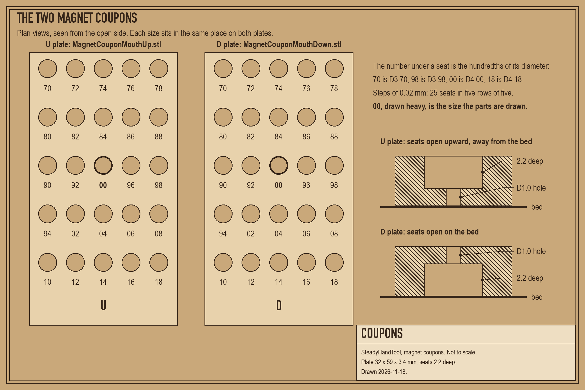

Together they test both ways a seat can print, which should carry over to the parts: check it on
one tool head and one interface ring before you print the rest (below). The parts' seats are drawn
⌀4.00 mm, the size chosen from these coupons on our printer, with the slicer's automatic hole
compensation turned off: the tightest seat a magnet still went into.

### How to use them

1. **Settle the profile first.** Use the printer, nozzle, filament, profile and speed you will
   print the parts with. Switch the slicer's **automatic hole compensation off** (in Bambu Studio,
   its automatic circle contour-hole compensation). Note the value of the slicer's **X-Y hole
   compensation** (Bambu Studio and OrcaSlicer: Quality, Precision). Call it H; it is 0 unless you
   have set it.
2. **Print both coupons as exported**, without turning either over.
3. **Turn the D plate over to read it.** It is the U plate turned over, so seen from the open
   side, with the letter band at the bottom, each size sits in the same place on both. Its numbers
   are pressed into the bed face and may print faint: read a D seat's size from the same place on
   the U plate. The `00` seat is the middle one of the third row on both.
4. **Press a magnet into each seat** by hand, with a printed sleeve or a rod about 3 mm across.
   A small hole goes through each seat's floor: push a magnet back out with a pin from the other
   side.
5. **Find the best seat**: the **smallest seat a magnet still goes into all the way, by hand**, and
   stays in when you hold the plate face down and tap it. Write down its number for each plate. If
   the plates disagree, go by the D plate.

### How to change the printer to match the models

Compare the best seat with `00` and change the slicer's X-Y hole compensation by **half the
difference**, from H, on the parts with magnet seats only. A positive value makes holes bigger, a
negative one smaller. H is the value the coupons were printed with (0 if you have set none):

| Best seat | Your holes print, against ours | Set the X-Y hole compensation to |
| :---: | :--- | :--- |
| `90` | about 0.10 mm larger | H − 0.05 mm |
| `94` | about 0.06 mm larger | H − 0.03 mm |
| `96` | about 0.04 mm larger | H − 0.02 mm |
| `98`, `00`, `02` | within normal print scatter | no change (see below) |
| `04` | about 0.04 mm smaller | H + 0.02 mm |
| `08` | about 0.08 mm smaller | H + 0.04 mm |
| `12` | about 0.12 mm smaller | H + 0.06 mm |

One step either side of `00` is within normal scatter: if the best seat is `98` or `02`, change
nothing unless both plates land on the same side of `00`. Any other best seat follows the same
rule: half its difference from `00`.

- **If a magnet goes into every seat**, first check that automatic hole compensation really is
  off; if it was on, turn it off and print the coupons again. If a magnet still goes into every
  seat, change the X-Y hole compensation by −0.05 mm and print the coupons again.
- **If it goes into none**, change it by +0.05 mm and print the coupons again.
- Repeat until the best seat is on the plates, then set the value the coupons were last printed
  with plus half that seat's difference from `00`: printed at −0.05 with a best seat of `80`, set
  −0.15 mm.
- **Check on the parts.** The setting changes every hole of the part it is set on, so print one
  tool head and one interface ring first: check that the head still seats on the ring, and fit a
  magnet into a seat on each face of the ring. Bambu Studio applies no hole compensation to an
  object painted in more than one colour.
- **Other slicers.** Only the Bambu Studio and OrcaSlicer settings are described here. Another
  slicer may have a setting that changes holes alone (Cura's Hole Horizontal Expansion is one), but
  it is untested on these parts, and its sign may be the reverse of the one above: read your slicer's help
  for which way it moves a hole, and use only a setting that leaves the outside of the part alone.
  Use the same rule, and check it with the coupons and on a tool head and a ring.

The depth of the seats, 2.1 mm, is a separate check, made with a caliper on the parts themselves
(sections 3 and 5).

## 2. The rule

Magnet orientation is the one part of this design that **cannot be recovered from a model
file**. An STL describes a magnet seat; it says nothing about which way the magnet in that seat
faces. Two people can print the same adapter from the same file, populate it correctly by every
visible measure, and end up with parts that push each other away.

The rule below fixes that, so a tool head designed by one person clicks into a tool built by
another.

> **Fixed parts present NORTH. Removable parts present SOUTH.**

Every magnetic joint in the tool has a fixed side and a removable side:

| Joint | Fixed side, presents **North** | Removable side, presents **South** |
| :--- | :--- | :--- |
| Tool head in the base | Base tool pocket, facing up | Tool head |
| Tool head on the carriage | Interface ring, bottom face, facing down | Tool head |
| Interface ring at the vertical cage | Vertical cage dock, facing down | Interface ring, top face, facing up |

**Every magnet in a single array shares the same pole.** There is no alternating pattern and no
keyed position. Any rotation seats correctly.

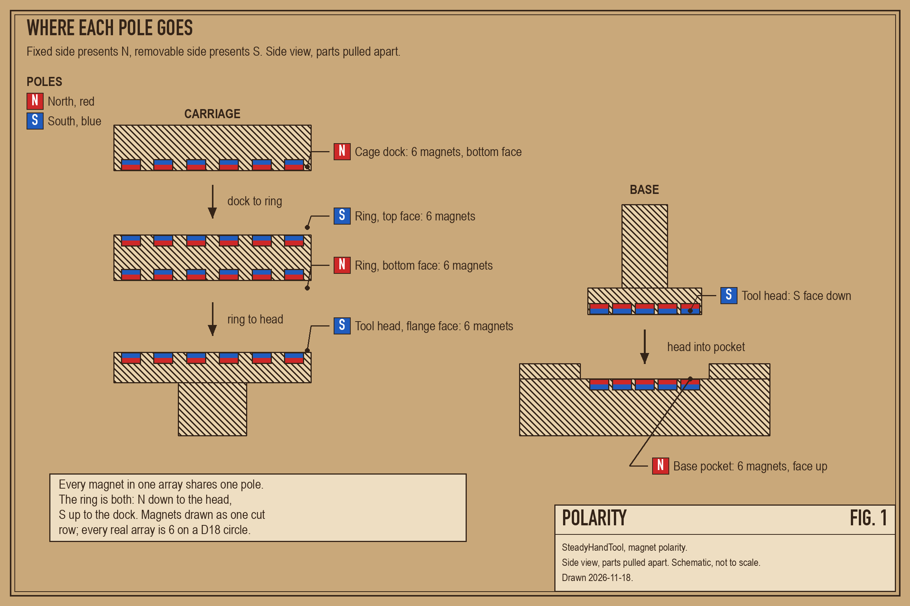

**The interface ring is on both sides of a joint**, the fixed side to the tool head below it and
the removable side to the vertical cage above it. All twelve of its magnets go in the same way up,
**north face down**: the bottom face then presents North and the top face South, which is what
both joints need. With the magnet pushers (section 4) this takes care of itself: the **N** pusher
fills the bottom face (the end of the narrow neck), the **S** pusher the top face (the wide flange
face). Both faces have six seats. From the stack
instead, fill the top face first. Then turn the ring over to fill the bottom face, and **turn the
stack over with it**: the bottom face's magnets then go in the other way up as you see them,
which is the same way up in the ring. Check each face with a compass (section 7).

A tool head's face points down when it sits in a base pocket and up when it is on the carriage;
it presents S either way. Rule of thumb: **fixed side → N pusher, removable side → S pusher.**

## 3. Where the magnets are

| Array | Magnets per part | Per kit | Pole it presents | Pattern | Pusher | Drawing |
| :--- | :---: | :---: | :---: | :--- | :--- | :---: |
| Base, each of the four tool pockets | 6 | 4 × 6 = 24 | **N** (up) | ⌀18 mm bolt circle, 60° apart | N (red) | [Fig. 5](illustrations/fig_5_base_top.png) |
| Tool head (tweezers and vacuum pen) | 6 | 2 × 6 = 12 | **S** | ⌀18 mm bolt circle, 60° apart | S (blue) | [Figs. 6-8](illustrations/fig_6_head_tweezers.png) |
| Interface ring, bottom face | 6 | 1 × 6 = 6 | **N** (down) | ⌀18 mm bolt circle, 60° apart | N (red) | [Fig. 9](illustrations/fig_9_ring_bottom.png) |
| Interface ring, top face | 6 | 1 × 6 = 6 | **S** (up) | ⌀18 mm bolt circle, 60° apart | S (blue) | [Fig. 10](illustrations/fig_10_ring_top.png) |
| Vertical cage dock | 6 | 1 × 6 = 6 | **N** (down) | ⌀18 mm bolt circle, 60° apart | N (red) | [Fig. 11](illustrations/fig_11_dock.png) |
| | | **54** | | | | |

The magnets are ⌀4 × 2 mm neodymium throughout. The arrays above take 54: 24 in the base, 12 in the two
tool heads, 12 in the interface ring and 6 in the vertical cage. The aligner, the stopper and the two
weight cups take six each, 24 more, so one tool takes 78 (the [BOM](BOM.md)). The published aligner
and stopper have no seats yet: their seated versions and the weight cups come with the next release,
and this guide will add their arrays then.

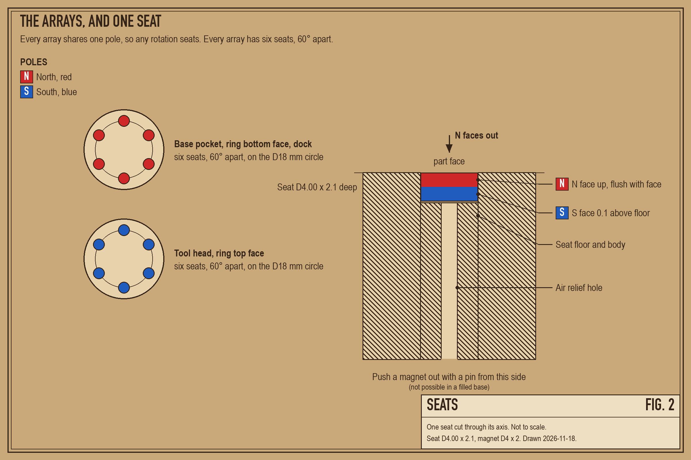

Every magnet seat on the tool's parts is ⌀4.00 mm and 2.1 mm deep, built for a ⌀4 × 2 mm magnet:
a magnet that bottoms in a seat has its face 0.1 mm below the part's face. Pushed with the pusher's
flat sleeve (section 4), it stops flush with the face, 0.1 mm above the seat floor, and the press
fit holds it where the sleeve left it. A 2.1 mm seat leaves no depth margin, so before any magnet
goes in, check one seat on each face of each part with a caliper's depth rod resting on the seat
floor beside the air-relief hole, not in it: it must read 2.1 mm. A seat that prints shallower
leaves a magnet standing proud of the face: clear it to 2.1 mm with a 4 mm drill turned by hand.
The seat depth, and the press fit that holds a magnet flush, are unverified until you have gauged
your own print. In the vertical cage dock the floor beside the hole may be too narrow for the rod;
there, check the magnets instead (section 7).

The small hole under each seat is air relief — it lets a magnet press home instead of riding on
trapped air. Its size differs from part to part. In the base it is not a through-hole to the
outside.

## 4. The two magnet pushers

There are two ways to install magnets: the magnet pushers, which pick the pole for you, and the
stack method (section 6), which needs nothing printed. The pushers are untested on
the parts themselves: if one does not reach a seat, or will not leave a magnet in it, use the
stack method for that part.

Two printed hand tools, one per pole. Each has two magnets, stacked, glued into its tip. A loose
magnet jumps onto the tip the right way round, and the tool presses it into its seat. **The letter
on a pusher is the pole that the magnet it seats leaves facing out.**

| Pusher | Letters | Use it for |
| :--- | :--- | :--- |
| **N** | red | The fixed side, which presents North: the base's tool pockets, the interface ring's **bottom** face (the end of the narrow neck), the vertical cage dock |
| **S** | blue | The removable side, which presents South: every tool head, the interface ring's **top** face (the wide flange face) |

### Why a pusher cannot seat a magnet the wrong way

Each pusher carries a magnet only by attraction to its **tip magnets**: two magnets, stacked and
glued into the tip as one. Two stacked magnets can only stack N to S, so the stack shows one pole
at the tip face and acts as one longer magnet. A loose magnet that jumps onto the tip turns until
its face against the tip is the tip's opposite pole. Pressed into a seat, that face stays on top,
so **the exposed face is always the opposite of the tip face, and the letter on the pusher names
it**:

- **N pusher**: tip face **S**, leaves **N** exposed.
- **S pusher**: tip face **N**, leaves **S** exposed.

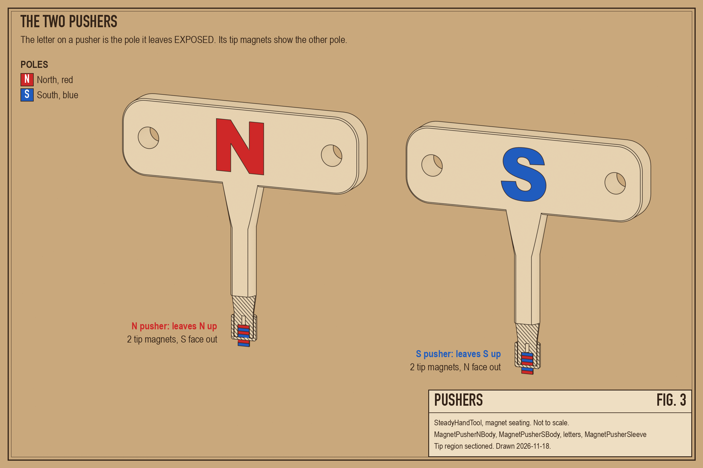
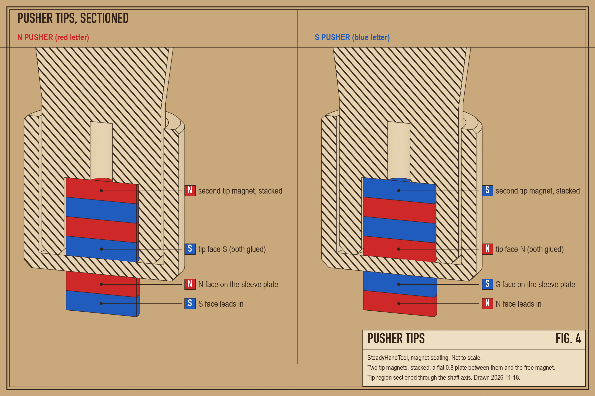

That leaves three ways to get the polarity wrong, and this document closes each one:

1. **The reference is wrong**: a tip stack glued the wrong way up, or a compass whose needle is
   itself reversed (section 5).
2. **The wrong pusher** for the array (section 6: one pusher on the bench at a time). The two
   bodies are the same shape; only the letter and its colour tell them apart.
3. **The wrong face of the ring up**: filling the ring's top face in an N session, or its bottom
   face in an S session (section 6: the face is named by which end of the ring it is, the narrow neck end
   or the wide flange face, checked before the first magnet; both have six seats).

### Making the pushers

**Make both pushers and check them before any magnet goes into a part.**

1. **Print both.** For each pusher, load its body and its two letters together in your slicer as
   one object with several parts (`MagnetPusherNBody.stl`, `MagnetPusherNLetterFront.stl`,
   `MagnetPusherNLetterBack.stl`; the same three for S, in
   [`hardware/models/stl/`](../hardware/models/stl)), and give the letters red (N) or blue (S).
   Print them lying flat, as the files are oriented. On a single-colour printer, print the body
   alone: the letter is then a recess, still readable. Print `MagnetPusherSleeve.stl` twice, one
   for each pusher, open end down, with a brim.
2. **Fit the tip magnets.** The pocket in the tip is 4 mm deep, for two magnets, and may print a
   little small. If the magnets do not go in, clear the hole with a 4.0 mm drill turned by hand,
   only down to the bottom of the hole: the outer magnet's face must end up level with the tip's
   face. Let two magnets snap together into a short stack, put a drop of glue in the pocket and
   press the stack in. The four tip magnets come from the spares: the [BOM](BOM.md) lists 90
   magnets for the 78 seats.
3. **Check its pole with a compass before the glue sets.** First make sure the compass points
   north when nothing magnetic is near. Then bring the tip in slowly from the side of the needle,
   from about 10 cm away, and stop as soon as the needle moves. **The N pusher's tip must pull
   the needle's marked (north-seeking) end towards it; the S pusher's tip must push it away.** If
   a tip does the opposite, take its stack out and put it back the other way up (if the two
   magnets come apart, let them snap together again first), then check again. Then let the glue
   set.
4. **Cross-check:** the two tips must snap together. If they push apart, one of the checks in
   step 3 was misread: do it again on both. Then glue a flat sleeve over each tip. It has
   no nose: its plate puts 0.8 mm between the tip magnets and the free magnet and stops on the
   part's face, leaving the magnet flush with the face. The sleeve is required for every seat.

## 5. The one-time set-up

The poles are defined by the compass, so the compass is checked before it is trusted, and again
after.

1. **Check your printer's seats first.** Before you print the parts that hold magnets, print the
   two magnet coupons and set your hole size as section 1 says. Then, on every part, check one
   seat on each face with a caliper's depth rod before any magnet goes in: 2.1 mm, as
   section 3 describes, and clear a shallow seat to 2.1 mm with a 4 mm drill turned by hand.
2. **Check the compass.** Away from steel, magnets and the bench, its needle must point north and
   agree with a second reference that does not use a needle (a phone's compass app, or a landmark
   you know is to the north). A needle that points south is reversed: do not use that compass.
3. **Make both pushers** as section 4 says, steps 1 to 4: print them, fit and glue the tip
   magnets, check each tip's pole with the compass before the glue sets, cross-check the two tips,
   and glue on the sleeves. **After each pusher, check the compass against north again** (step 2).
   If it has moved, the needle was disturbed: use another compass and check that pusher's tip
   again. Never turn one tip magnet over on its own, and never relabel a pusher.
4. **Optional: a magnetic pole tester** (a Hall-effect sensor that reads N or S). Tie it to the
   pushers: on the N pusher's tip it must read **S**, on the S pusher's tip **N**. If the tester
   and the compass disagree, stop, check the compass against north again (step 2) and check both
   tips again. If both still check, the tester's convention is the reverse of this guide's: do
   not use it.
5. **Prove your pole check**, whether it is the tester or the compass: in a spare tool head, seat
   five magnets with the S pusher and one the wrong way up (pick it up on the tip, pull it off,
   turn it over, press it in with a non-magnetic rod). Checking one magnet at a time, as
   section 7 does, your check must single out the odd one at every seat you try it in. A check
   that cannot is not used: a compass whose needle the neighbouring magnets swing is no proof of
   one magnet's pole. Then push the reversed magnet out through its air-relief hole with a pin.
6. **Make three masters** with the pushers, checking every magnet, and keep them apart from the
   parts that go into kits:
   - **Master head**: one tool head, S pusher, 6 of 6 S, marked "MASTER" in blue.
   - **Master ring**: one ring, bottom face with the N pusher (6 of 6 N) and top face with the S
     pusher (6 of 6 S), marked "MASTER" in red on the bottom face and in blue on the top.
   - **Master dock**: one spare dock part, N pusher, 6 of 6 N, marked "MASTER" in red.
   - The master head must snap flat onto the master ring's bottom face at every 60° step, and the
     master ring's top face onto the master dock at every 60° step. Like the cross-check of the
     two tips, this proves only that the masters are opposite pairs; the compass checks prove
     which pole is which.

## 6. Filling the magnets

### With the pushers: work by pole, not by part

1. **One pusher on the bench at a time.** An N session fills every N array of the batch (base
   pockets, ring bottom faces, the dock) while the S pusher stays in its drawer. Then an S session
   (tool heads, ring top faces) with the N pusher put away. **Start with the N session.**
2. **Gauge the seats before the first magnet**, on every part of the batch: one seat on each face,
   as section 5, step 1 says. On the vertical cage dock, where the depth rod may not fit beside
   the air-relief hole, check the depth of its magnets instead (section 7).
3. **Parts by pole:** the session's parts sit on a tray labelled with that pole, and a part leaves
   the tray only after its checks (section 7).
4. **Rings: check which face is up before the first magnet**: the end of the narrow neck in an N
   session, the wide flange face in an S session (both have six seats, so the count cannot tell them apart). A ring is finished only when both faces are checked.
5. **Each magnet:** slide ONE magnet off the stack onto a non-steel surface, touch the tip to it
   so it jumps on, hold the pusher upright over the seat, press straight down until the sleeve's
   plate stops on the part's face, and lift straight up. The magnet should now be flush with the
   face; if it stands proud, press it again. If it still stands proud, its seat is shallow: lift
   the magnet out, clear the seat to 2.1 mm as described in section 3, and fill it again. A magnet that comes loose goes back on the tip, never in by finger: by hand it
   can go in upside down.
6. **If the pusher lifts a magnet back out of its seat or chips its edge,** fill that part from
   the stack instead.

### Without the pushers: from the stack

Neodymium magnets ship as a stack, uniformly polarised. **Do not separate the stack and sort the
magnets.** Slide one magnet off the end of the stack at a time, drop it straight into its seat
without turning it over, and press it down with something non-magnetic: a spare flat
sleeve, printed loose and held in the fingers (its plate stops on the face and leaves the magnet
flush), or a wooden or plastic rod narrower than the seat, about 3 mm across, which can push it to
the seat floor, 0.1 mm below the face. Every magnet then lands the same way round, and you only have to verify the array
once rather than six times.

If a magnet flips itself as it approaches the seat, it was already attracted to a neighbour in
the wrong orientation — take it out and start that seat again.

## 7. The checks

**With a compass.** A compass needle's marked, north-seeking end is a magnetic *north* pole, so it
is attracted to a magnet's *south* pole. Hold the compass over one seated magnet of the array:

- On a part that presents **North** (a base pocket, the ring's bottom face, the cage dock), the
  marked end should be **pushed away**. If it is pulled in, the array is inverted.
- On a part that presents **South** (a tool head, the ring's top face), the marked end should be
  **pulled in**. If it is pushed away, the array is inverted.

**Against known-good hardware.** Offer a factory-built tweezers head to a base pocket or to the
bottom of an interface ring. If it snaps flat and stays put at every rotation, the array is
correct. If it pushes away or sits proud on one side, the array is inverted.

For a single part, both methods put every magnet of an array in the same way round, so one check
settles the array, as long as no magnet was put back by hand. **When you fill a whole kit, check
more than that**, for each array, before the part leaves the tray:

- **Every magnet's pole**, not one per array, one magnet at a time, with the check you proved in
  section 5, step 5 (the tester, or the compass held as above). This is the check that finds one
  reversed magnet among five right ones, the mistake section 11 calls the one worth avoiding.
- **Against the master that is the array's real mate:** a base pocket or a ring's bottom face (N,
  six seats) must hold the **master head** flat at every 60° step; a tool head (S, six seats) the
  **master ring's bottom face**; a ring's top face (S, six seats) the **master dock** at every
  60° step; the dock (N, six seats) the **master ring's top face**. Rocking, or an edge standing
  proud at any step, means a reversed or a proud magnet. The magnets meet almost face to face (each
  is flush with its face), so the snap is firm: this check backs up the pole check, it does not replace it.
- **Depth:** every magnet is flush with the face as pushed (0.1 mm below it where it bottoms in
  the 2.1 mm seat), and none stands proud: a 0.1 mm feeler gauge drawn across the seat must pass
  over it freely. A depth rod cannot resolve the 0.1 mm recess.
- **Mark** the finished face with a paint dot in its pole colour (red N, blue S) on a face that is
  not seen in use, and tick the batch sheet: part, face, seat count, pole, magnets checked (6 of 6), master check, depth, initials.

**The base: check every magnet's pole as soon as it is seated**, not once the pocket is full. The
base top's air-relief holes open on its underside, into the shot chamber, so a pin cannot reach
them while the top is screwed on. If one goes in the wrong way, stop, and do not pry it out from
the face: with the top unscrewed and the shot cleared from its underside, try pushing it out
through its air-relief hole with a pin.

**Whole-kit check, last:** each of the two tool heads into every base pocket (8 pairs) and onto the
ring (2 pairs), and the ring onto the dock (1 pair): each must snap flat at any rotation.

## 8. The drawings

Each of Figs. 5 to 11 cuts a part through two of its seats and shows the seated magnets in their
pole colours (**N red, S blue**), with the pusher that fills them: its sleeve fitted, and its two
tip magnets and the loose magnet on its sleeve cut through. Each part is drawn as it lies while you
fill it, magnet face up; where that face points down in use, the drawing says so.

| Fig. | Shows | Magnets | Pole it presents |
| :--- | :--- | :---: | :--- |
| [1](illustrations/fig_1_joints.png) | Where each pole goes, joint by joint (section 2) |  |  |
| [2](illustrations/fig_2_seat.png) | The arrays in plan, and one seat cut through (section 3) |  |  |
| [3](illustrations/fig_3_tools.png) | The two magnet pushers |  |  |
| [4](illustrations/fig_4_tools_tips.png) | The pusher tips, cut through |  |  |
| [5](illustrations/fig_5_base_top.png) | Base top, one tool pocket | 6 × 4 | N |
| [6](illustrations/fig_6_head_tweezers.png) | Tool head, tweezers | 6 | S |
| [7](illustrations/fig_7_head_template.png) | Tool head, template | 6 | S |
| [8](illustrations/fig_8_head_vacuumpen.png) | Tool head, vacuum pen | 6 | S |
| [9](illustrations/fig_9_ring_bottom.png) | Interface ring, bottom face | 6 | N |
| [10](illustrations/fig_10_ring_top.png) | Interface ring, top face | 6 | S |
| [11](illustrations/fig_11_dock.png) | Vertical cage dock | 6 | N |
| [12](illustrations/fig_12_rig.png) | The magnet rig (section 9) |  |  |

**Reading the base top (Fig. 5), the first part to fill.** The seated magnets must show N on top.
The pusher for that is the **N pusher**, red letter N: the letter names the pole it leaves
exposed, not the pole of its own tip magnets. Its two tip magnets are glued **S face out**. A
loose magnet jumps onto that S face with its **N face**, so its **S face** leads: it goes into the
seat S first, and N is left on top, flush with the face once the sleeve's plate stops on it.
Every other part follows the same chain with its own pusher (section 4).

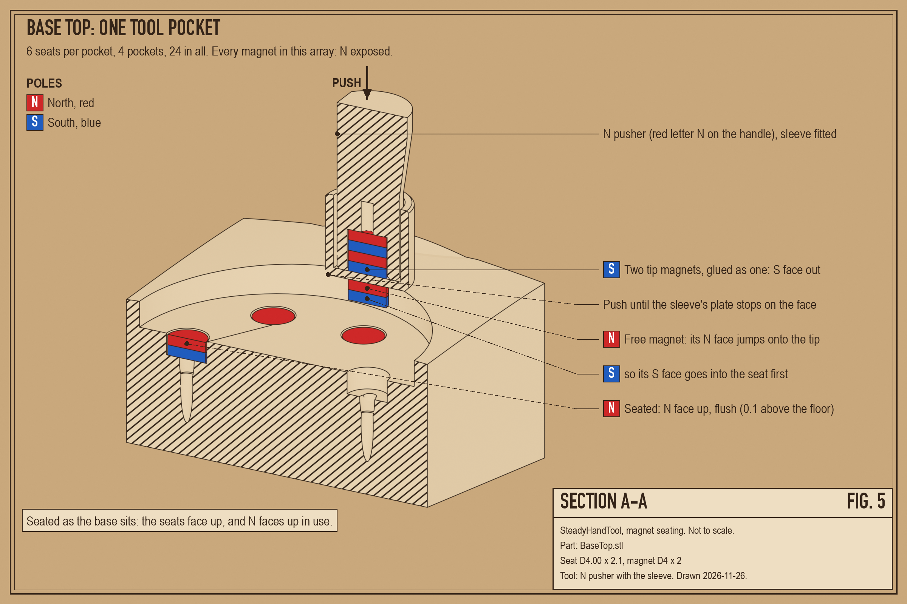
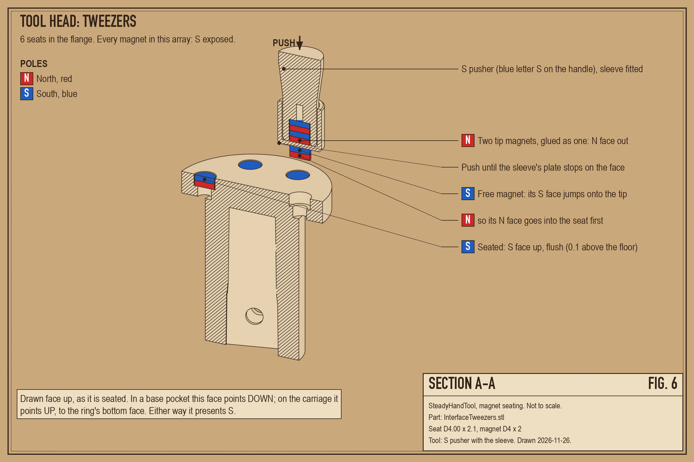
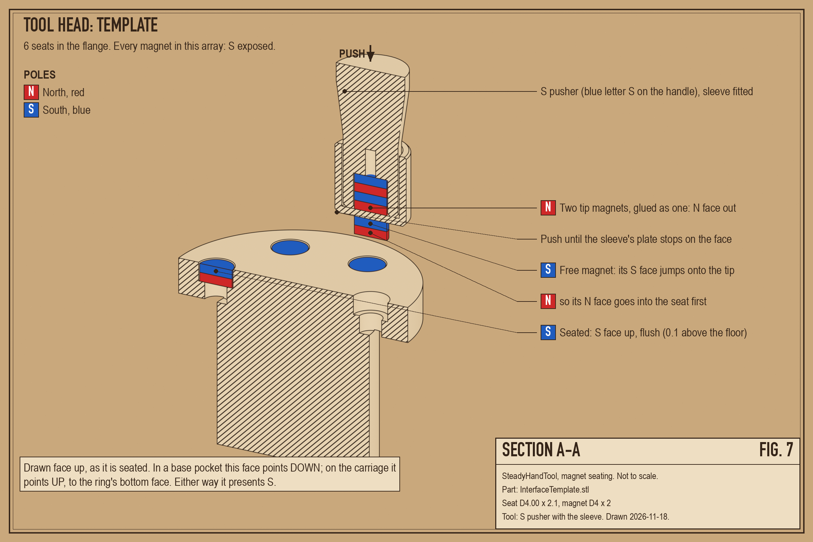
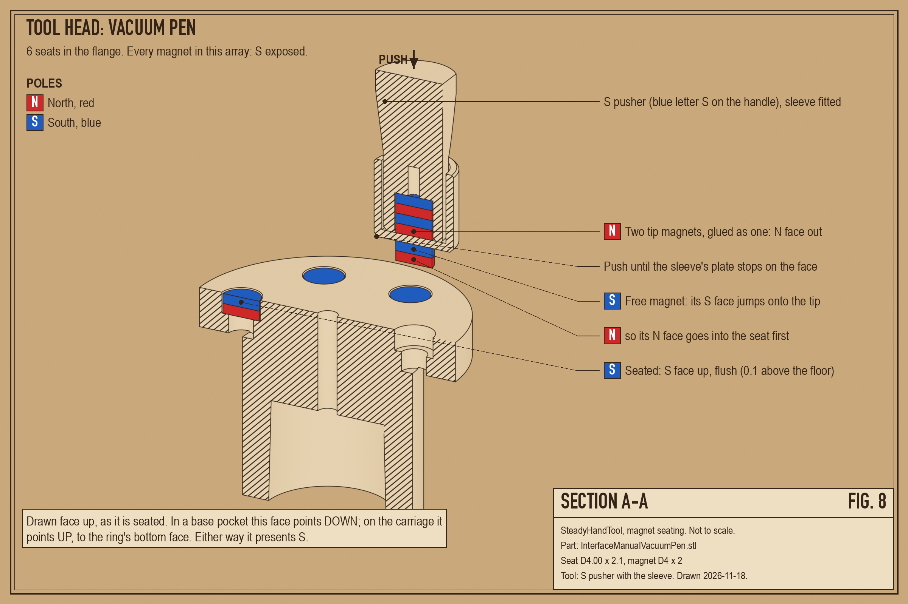
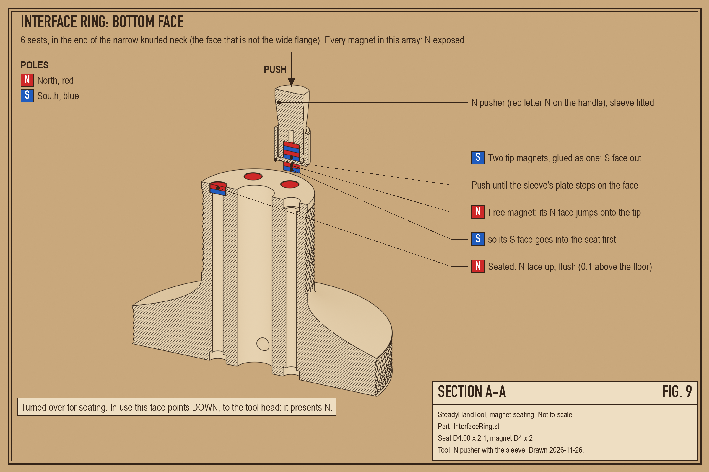
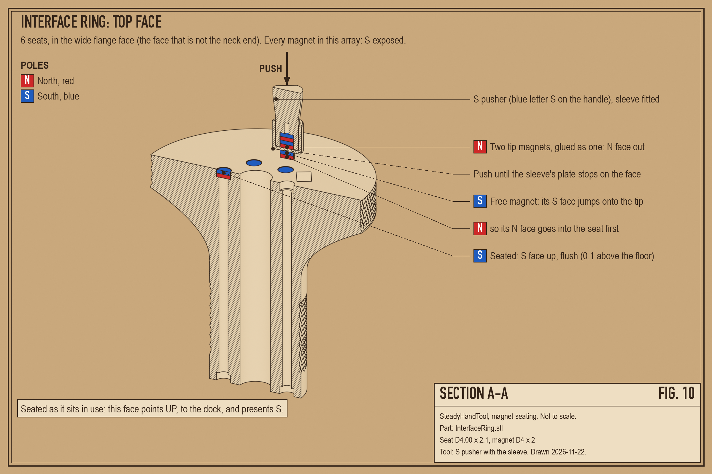
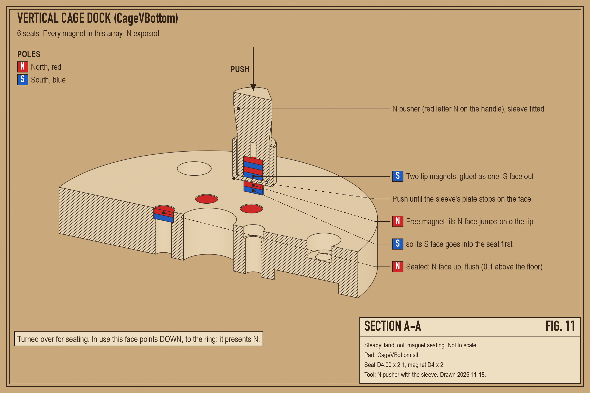

## 9. The magnet rig: the base's tool pockets, guided

An optional guide for seating the 24 magnets of the base's four tool pockets, all **North**
exposed. A puck sits in the pocket and lines a pusher up over each seat in turn, and a groove on
the pusher shows when the magnet has gone fully home. The N pusher (section 4) is all a base
pocket needs; the rig is for the base pockets only: not for tool heads, the interface ring or the
dock.

**The rig is made for the 2.1 mm seats.** Its cap is a flat plate, like the pushers' sleeve: the
stem stops on the pocket floor around the seat, and the magnet it carries ends flush with the
floor, 0.1 mm above the bottom of the seat. That depth is what the design gives; the rehearsal at
the end of this section must confirm it.

**The rig is untested on a printed base: test it before you rely on it.** Accept it only after the rehearsal at the end
of this section. If it fails any part of it, seat the pockets with the N pusher instead.

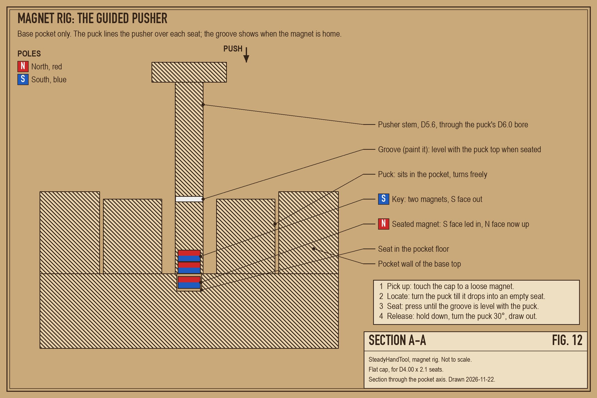

### What you need

| Item | Notes |
| :--- | :--- |
| `MagnetRigPuck.stl` | Print flat, top face up. It is drawn ⌀26.90 for a pocket that prints ⌀27.2; step 9.1 fits it to yours |
| `MagnetRigPusher.stl` | Print standing, hex handle on the bed. The pocket at the top of its ⌀5.6 stem prints open, with nothing to bridge |
| `MagnetRigCap.stl` | The cap: a flat ⌀5.6 × 0.6 mm plate. Print flat, glue face on the bed. It closes the pocket in the stem, and the magnet hangs on its face |
| 6.0 mm drill bit | To open the puck's bore, turned by hand |
| 2 magnets and 5-minute epoxy | The key in the pusher's stem: two more magnets on top of the kit's |
| Compass | The reference for the key's pole, as in section 4 |
| Straightedge and 0.1 mm feeler gauge | Finds a magnet standing above the pocket floor |
| Paint marker | To fill the groove on the stem so it can be seen |
| Magnetic pole tester (optional) | A Hall-effect sensor that reads N or S, tied to the compass in step 9.2 |

The STL files are in [`hardware/models/stl/`](../hardware/models/stl).

### 9.1 Fit the puck to your pocket

1. On the printed BaseTop, before it goes onto a filled cup, measure one tool pocket across at
   three or more places, square to the pocket's axis: the pocket is tilted, so it prints a little
   out of round. Take the smallest reading.
2. The puck must be 0.3 mm smaller across than that reading. If your reading is not 27.2 mm,
   scale the puck in X and Y only, by (reading − 0.3) / 26.90, and leave Z at 100%. Print it.
   Scaling also moves the bore off the seat circle a little, so it holds only for a reading from
   26.9 to 27.5 mm; outside that, seat the pockets with the N pusher.
3. Open the puck's bore to ⌀6.0 with the drill, turned by hand. The pusher's stem must slide
   through it freely, and the puck must drop into the pocket and turn in it freely.

### 9.2 Make the pusher's key (once)

1. Let two magnets snap together into a short stack. Put the pusher's stem through the puck's
   bore, put a drop of epoxy in the pocket at the top of the stem, press the stack in and glue the
   cap over it.
2. **Check the key's pole before the epoxy sets.** As in section 4, step 3, with the compass
   pointing north and nothing magnetic near, bring the cap in slowly from about 10 cm. **It must
   pull the needle's marked (north-seeking) end towards it**: the key's face is then South, and the
   magnets it seats leave North exposed. If it pushes the marked end away, take the stack out,
   turn it over and check again. Then lay a loose magnet on the cap while the epoxy cures, so the
   key is pulled hard against the cap.
3. The pusher is marked **N** for the pole it leaves exposed, as the N pusher is. Its key reads S.
   Do not turn the key over to match the letter.
4. If you use a pole tester, hold it to the cap: it must read **S**. If it reads N, stop, check the
   compass against north again and the key's pole again; if both still check, the tester's
   convention is the reverse of this guide's: do not use it. Then prove your pole check as
   section 5, step 5 says.
5. Fill the groove on the stem with the paint marker.

### 9.3 Seating, one magnet at a time

1. **Pick up.** Slide one magnet off the stack onto a non-steel surface, away from the stack, and
   touch the cap to it. It turns over by itself and hangs from the cap. There must be exactly one
   magnet, flat and centred on the cap; if not, put it down and pick it up again. **Never drop a
   magnet into the bore by hand, and look into the bore before the pusher goes in: it must be
   empty.**
2. **Locate.** Puck in the pocket. Pusher into the bore from the top, magnet first. Turn the puck
   until the magnet drops into an **empty** seat.
3. **Seat.** Press down until the stem stops on the pocket floor around the seat. The magnet then
   sits in the seat, flush with the pocket floor. **The groove on the stem must be level with
   the puck's top face.** A groove that stands high means the stem did not land, or it landed on a
   magnet already in that seat: lift and locate again. If the carried magnet stays behind on a
   seated one, it stands proud, North up: take the puck out, push the loose magnet off sideways
   and start it again from step 1. Then check the seated one's depth again, and that it is not
   proud (step 9.4).
4. **Release.** Hold the pusher down, turn the puck 30°, to midway between two seats, then draw
   the pusher straight up.
5. A magnet that is ever loose in the pocket goes back only through step 1, never in by finger.

### 9.4 Checks, independent of the rig

Check each magnet as section 7 says, **each as soon as it is seated**: the base's air-relief holes
open into the shot chamber, so a pin cannot reach them once the top is on a filled cup.

- **Pole:** every magnet reads **North**.
- **Depth:** each magnet should be flush with the pocket floor. The rig is untried on a printed base, so
  gauge it and note it.
- **Proud:** lay the straightedge across each seat along the pocket's layer lines, square to the
  line from the base's centre through the pocket's centre. Laid the other way, it rocks on the
  stepped floor and the feeler can pass under it on texture alone. The 0.1 mm feeler must not
  pass under it.

### Rehearsal: accept the rig only when all of these hold

Do it on one pocket of the BaseTop, before it goes onto a filled cup, so a pin can still reach
the air-relief holes from underneath.

- A magnet seats with the groove level with the puck's top face, and no magnet stands proud of the
  pocket floor. Record the depth it leaves the magnet at.
- It stays seated when the puck is turned 30° with the pusher held down and the pusher is then
  drawn out.
- Drawing the pusher out does not lift a magnet in a neighbouring seat.
- Pressed over a seat that already holds a magnet, the groove stands high.
- With five magnets seated by the rig and one put in the wrong way up (picked up on the cap, pulled
  off, turned over and pressed in with a non-magnetic rod), your pole check singles out the odd
  one. Then try pushing it out through its air-relief hole with a pin, from underneath.
- No magnet in the pocket stands proud.

## 10. The first build

1. Section 5, steps 1 to 3: the coupons and seat depths, the compass, then both pushers made and
   checked.
2. Section 5, steps 4 and 5: tie the pole tester to the pushers, if you use one, and prove your
   pole check on a spare tool head.
3. Section 5, step 6: the masters. They are the first full arrays you fill with the pushers (a
   tool head, both faces of a ring, a dock): check each as section 7 says, and look for any
   magnet the tip lifted back out of its seat or chipped. If the pushers do that on your parts,
   fill those parts from the stack instead (section 6).
4. One base pocket, in an N session, checked as section 7 says against the master head. If you
   use the rig, this is its rehearsal (section 9).
5. Then the rest of the kit, by sections 6 and 7.

## 11. If you get it wrong

A fully inverted array is harmless and reversible — the part simply will not stick, and the
magnets press out from the relief hole with a pin. A *single* reversed magnet among five correct
ones is the case worth avoiding: the part still holds, but it rocks on the odd magnet and the
holding force drops noticeably. That is why the whole array shares one pole. There is no phase to
get right, and a mistake is obvious rather than subtle.

## 12. Hardware built before this standard

This document fixes the convention going forward. Prototypes assembled before it exists may be
polarised either way, because nothing recorded which way they went — that is the whole reason for
writing it down.

**Build production hardware to the rule in section 2, not to a prototype.** If an old base and a new
tool head push apart, the old base predates the convention; it is not evidence that the
convention is wrong.

Re-polarising an existing part is straightforward and reversible. Push each magnet out through
its air-relief hole with a pin, turn it over, and press it back in, down to the seat floor as in
"Without the pushers" (section 6). There is no adhesive and nothing to damage.

## 13. For tool head designers

Build to **south exposed** and your head will seat in any base pocket and on any interface ring
built to this standard, at any rotation. Copy the seat pattern from `InterfaceTemplate.stl` rather than re-deriving it —
the ⌀18 bolt circle with six seats 60° apart is what makes the parts interchangeable, and the
polarity rule above is what makes them interchangeable *between owners*.

## 14. Why not alternating poles

Alternating north and south around the ring would hold harder, because flux closes between
neighbours, and it would key the head to three rotational positions. It was rejected: a
mis-phased head would actively *repel* its base, which is a poor failure mode for someone seating
a tool one-handed with a tremor. Uniform polarity trades some holding force for an interface that
cannot be assembled out of phase.
