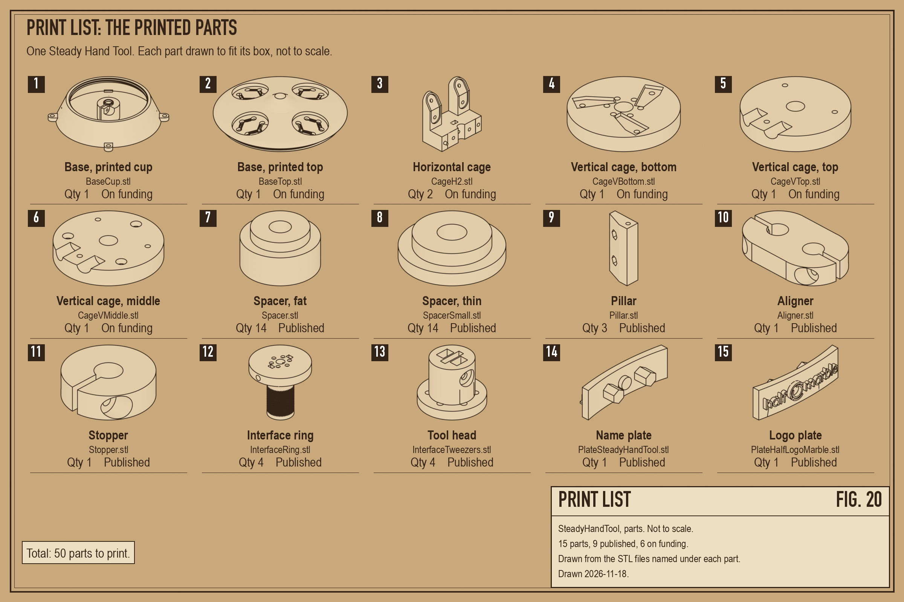
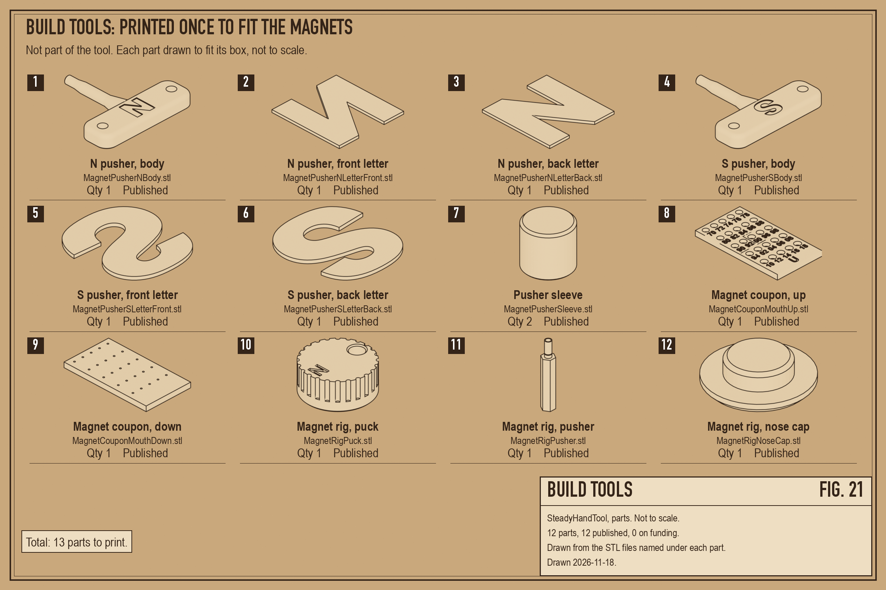
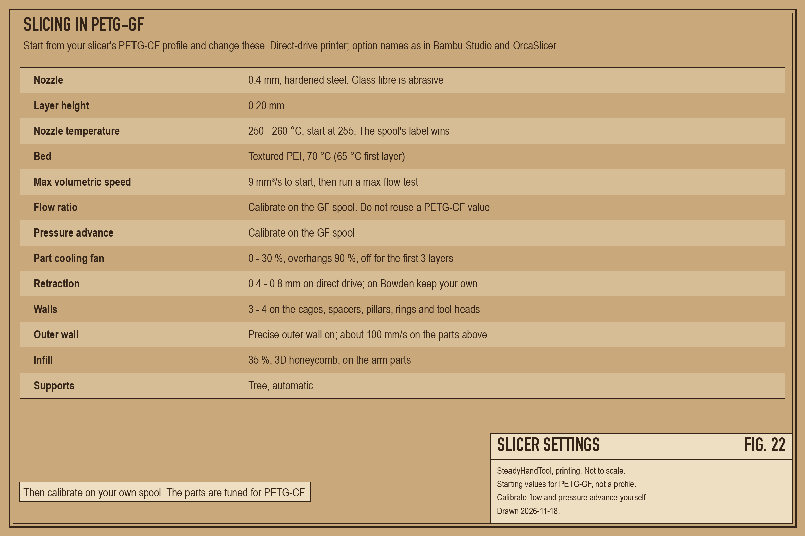

# Print list

Every 3D-printed part of one Steady Hand Tool, and how many copies to print. Fasteners, bearings,
rods, magnets and the base ballast are not printed: they are in the [BOM](BOM.md), and the
fastener counts are in the [assembly guide](assembly-guide.md#-preparation-fasteners-sorting).

- **Base.** Print the BaseCup and the BaseTop (assembly guide, Step 1 and Fig. 13). The
  ballast, 1/4 in steel balls filled by weight, is in the BOM.
- **Spacers.** One fat and one thin spacer per bearing set, 14 sets.
- **Tool heads.** Four, one for each pocket in the base. Any of them can be
  `InterfaceManualVacuumPen.stl` instead, or a head of your own made from `InterfaceTemplate.stl`.
  Every head has to follow the [magnets guide](magnets.md).
- **Optional.** The adapter for the third-party PixelPump pen in `hardware/models/3rdParty/` is
  not counted above.
- **On funding** parts are not in this repository yet. Every 3D model is published when the
  campaign funds.

The published parts in Fig. 20 are in [`hardware/models/stl/`](../hardware/models/stl/).

## Build tools

These are printed once to fit the magnets. They are not part of the tool. Use them as the
[magnets guide](magnets.md#4-the-two-magnet-pushers) describes.

- **Magnet coupons.** Print these two first, before any part with magnet seats, to check that
  your printer makes seats that grip the magnets: see
  [the hole size on your printer](magnets.md#1-dial-in-your-printer-first-the-two-magnet-coupons).
- **Letters.** They are for a two-colour print. On a single-colour printer, print each body alone
  (step 1 of [making the pushers](magnets.md#making-the-pushers)).
- **Magnet rig.** Optional, for the base's tool pockets only, and not yet used on a printed base.
  Fit the puck to your pocket before you print it: see the
  [magnet rig](magnets.md#91-fit-the-puck-to-your-pocket).
- **Without the pushers**, print one sleeve, loose, to press the magnets in from the stack, or
  use a rod about 3 mm across.

## Slicing in PETG-GF

The parts are tuned for PETG-CF. To print them in PETG-GF, start from your slicer's PETG-CF
profile, change the values below, then calibrate on your own spool. The values are for a
direct-drive printer, with option names as in Bambu Studio and OrcaSlicer; where your slicer
has no such option, skip only that option.

- **Keep the 0.4 mm nozzle.** The small features are sized for it, so do not switch to the
  0.6 mm nozzle often suggested for fibre-filled filament.
- **Dry the spool first**, about 65 °C for 6 - 8 h. Wet PETG-GF strings and prints weak.
- **Avoid a smooth PEI plate.** PETG can bond to it hard enough to pull the coating off.
- **Test the fits before printing the set.** PETG-GF shrinks differently from PETG-CF, so holes
  come out a little different in size. Print one horizontal cage and check that its bearings
  seat, and print one tweezers head and check that it homes in its pocket. If you print the base,
  check that the top threads into the cup before you fill it.
- **The printed cup and top get heavier.** PETG-GF is usually denser than PETG-CF, so they
  weigh more and the base needs less shot. Weigh the base, as
  [Step 1 of the assembly guide](assembly-guide.md#step-1-base) says.
